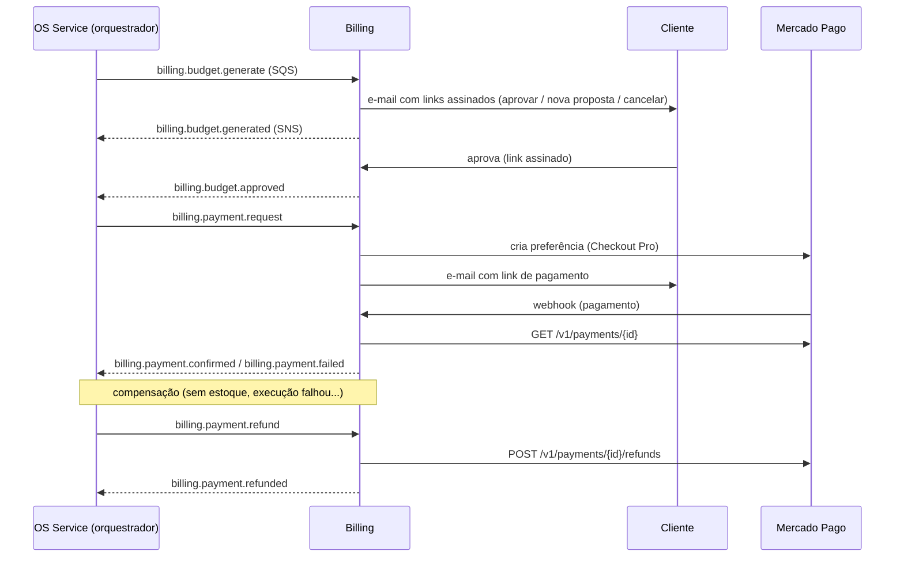

# oficina-billing-service

**Billing Service** do Tech Challenge **Fase 4 — Oficina Mecânica**. É responsável pelo **orçamento** (geração, envio ao cliente e aprovação) e pelo **pagamento via Mercado Pago** (Checkout Pro, webhook e estorno). Participa da **Saga orquestrada** da OS, comandada pelo OS Service.

| Repo | Papel |
|---|---|
| [oficina-api](https://github.com/MicaelHernandes/oficina-api) | OS Service: clientes, veículos, catálogo, estoque e OS; **orquestrador da saga** (PostgreSQL) |
| **oficina-billing-service** (este) | Orçamento e pagamento (**DynamoDB**) |
| oficina-execution-service | Fila de execução (PostgreSQL) |
| [oficina-k8s-infra](https://github.com/MicaelHernandes/oficina-k8s-infra) | VPC, EKS, ECR, ALB, DNS/TLS, monitoring, OIDC |
| [oficina-db-infra](https://github.com/MicaelHernandes/oficina-db-infra) | RDS PostgreSQL |
| [oficina-auth-lambda](https://github.com/MicaelHernandes/oficina-auth-lambda) | Lambda de auth por CPF + API Gateway |

## Tecnologias

- **PHP 8.4 / Laravel 13**, DDD em `src/Billing` (Domain, Application, Infrastructure, Presentation).
- **Amazon DynamoDB** (banco NoSQL do serviço), **SNS + SQS** (mensageria da saga), **Mercado Pago** (API REST).
- **Pest** (testes), **Pint**, **PHPStan/Larastan** (nível 5), **l5-swagger**, **prometheus_client_php** (APCu).
- **Docker** (php-fpm) + **nginx sidecar**, **Kustomize**, **Terraform** (`infra/`), deploy no **EKS**.

## Papel na saga



| Comando recebido | O que o Billing faz | Evento publicado |
|---|---|---|
| `billing.budget.generate` | Cria a revisão do orçamento (a anterior pendente fica `superseded`) e envia o e-mail | `billing.budget.generated` |
| (cliente aprova ou recusa pelo link) | Decide o orçamento | `billing.budget.approved` / `billing.budget.rejected` (`final`) |
| `billing.payment.request` | Cria a cobrança e a preferência no MP e envia o link | — (aguarda o webhook) |
| (webhook do MP) | Consulta o pagamento e atualiza a cobrança | `billing.payment.confirmed` / `billing.payment.failed` |
| `billing.payment.refund` | Estorna no MP, se pago, e cancela o orçamento | `billing.payment.refunded` (`refunded: true/false`) |
| `billing.payment.cancel` / `billing.budget.cancel` | Cancela a cobrança pendente e o orçamento | — |

**Garantias:**

- Cada comando grava **inbox** (idempotência), **estado** e **outbox** numa única `TransactWriteItems`: ou tudo é gravado, ou nada.
- O `billing:relay` publica o outbox no SNS depois do commit.
- O estorno sempre responde, mesmo sem nada a estornar, para a saga fechar.
- Notificações repetidas do MP não alteram uma cobrança já decidida.

## Modelo no DynamoDB (tabela única `oficina-billing`)

| PK | SK | GSI1 (por OS) | GSI2 (outbox pendente) |
|---|---|---|---|
| `BUDGET#<id>` | `BUDGET` | `OS#<os>` / `BUDGET#<rev>#<criado>` | |
| `PAYMENT#<id>` | `PAYMENT` | `OS#<os>` / `PAYMENT#<criado>` | |
| `INBOX#<msg>` | `INBOX` | | (TTL) |
| `OUTBOX#<msg>` | `OUTBOX` | | `OUTBOX#PENDING` / `<ocorrido>#<msg>` (esparso) |

**Por que NoSQL aqui:** orçamento e cobrança são documentos (itens, cliente e payload do gateway) acessados por chave ou por OS, sem joins. O DynamoDB é serverless (on-demand, sem pod nem instância no nó único do EKS) e tem transações para o padrão inbox/outbox.

## Rotas (prefixo `/billing/api`, roteado pelo ALB em `app.codefive.com.br`)

| Rota | Uso |
|---|---|
| `GET public/budgets/{id}` · `…/approve` · `…/reject[?final=1]` | Links assinados enviados ao cliente |
| `POST webhooks/mercadopago` | Notificação do MP (valida `x-signature` quando há `MERCADOPAGO_WEBHOOK_SECRET`) |
| `GET public/payments/{id}/fake-checkout` · `POST …/pay` | Checkout simulado (só com `PAYMENT_DRIVER=fake`) |
| `GET order-services/{osId}` | Orçamentos e cobranças da OS (interno, `Bearer BILLING_INTERNAL_TOKEN`) |
| `GET billing/api/documentation` | Swagger |
| `GET /metrics` | Prometheus (só dentro do cluster) |

## Mercado Pago

- **Produção/sandbox:** cadastre as credenciais no Secrets Manager. O deploy liga `PAYMENT_DRIVER=mercadopago` quando há `access_token`:
  ```bash
  aws secretsmanager put-secret-value --secret-id /oficina/billing/mercadopago \
    --secret-string '{"access_token":"TEST-...","webhook_secret":"..."}'
  ```
  No painel do MP, configure o webhook de **Pagamentos** para `https://app.codefive.com.br/billing/api/webhooks/mercadopago`. Com credenciais de teste, o link usa o `sandbox_init_point`.
- **Sem credenciais:** `PAYMENT_DRIVER=fake`. O link de pagamento abre o checkout simulado, onde `POST {"status":"approved"|"rejected"}` produz o mesmo efeito do webhook. Isso serve para demonstrar a saga.

## Observabilidade

- **Logs JSON** no stdout com `request_id` (HTTP) ou `saga_id`, `correlation_id` e `os_id` (workers). O `correlation_id` é o mesmo da abertura da OS no OS Service, para rastrear o fluxo no Loki.
- **`/metrics`:** latência por rota, `oficina_billing_mercadopago_webhooks_total{result}` e `oficina_billing_outbox_pending_messages`.

## Desenvolvimento local

```bash
composer install
cp .env.example .env && php artisan key:generate
docker run -d -p 8000:8000 amazon/dynamodb-local
php artisan billing:dynamodb-table
php artisan test --coverage   # Pest (precisa do DynamoDB Local)
./vendor/bin/pint --test
./vendor/bin/phpstan analyse --memory-limit=1G
```

## Testes e cobertura

**50 testes, cobertura de 96%** (mínimo de 80% exigido no CI). Os testes cobrem:

- os comandos da saga e a idempotência;
- links assinados e renegociação;
- o checkout simulado;
- o Mercado Pago com `Http::fake`: criação da preferência, webhook com e sem assinatura e estorno;
- os workers, os adaptadores SNS/SQS e as entidades.

O relatório `coverage.xml` de cada execução fica como artefato do workflow **CI**.

## CI/CD

- **`ci.yml`** (PR e push em `homolog`/`master`): Pint + PHPStan + Pest com DynamoDB Local (cobertura ≥ 80%) + `terraform fmt/validate` + `docker build`.
- **`deploy.yml`** (push em `master`, `environment: production`):
  1. `terraform apply` da `infra/`;
  2. build e push no ECR;
  3. Secret (Secrets Manager) e ConfigMap de runtime (SSM);
  4. IRSA no ServiceAccount;
  5. `kubectl apply -k k8s/overlays/prod`;
  6. `rollout status`.
- **Secrets do repositório:** `AWS_ROLE_ARN` (role OIDC `oficina-gha-oficina-billing-service`) e `LARAVEL_APP_KEY`. Environment `production`.
- Actions fixadas por SHA do commit.

## Dependência de ordem

1. **oficina-k8s-infra** (ECR, OIDC com DynamoDB/SNS/SQS, `/oficina/eks/oidc_provider_arn`).
2. **oficina-api** com a `infra/` aplicada (tópico `oficina-os-events`, lido em `/oficina/messaging/os-service/topic_arn`).
3. **Este repositório.**
4. De volta ao **oficina-api**: incluir `oficina-billing-events` em `consumed_topics` para o OS Service receber os eventos do Billing.

## Custo

DynamoDB on-demand, SNS e SQS cobram por uso (centavos no volume do desafio). Os pods rodam no EKS existente. **Destruir o ambiente após a apresentação.**
